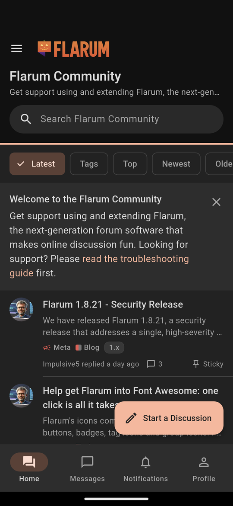
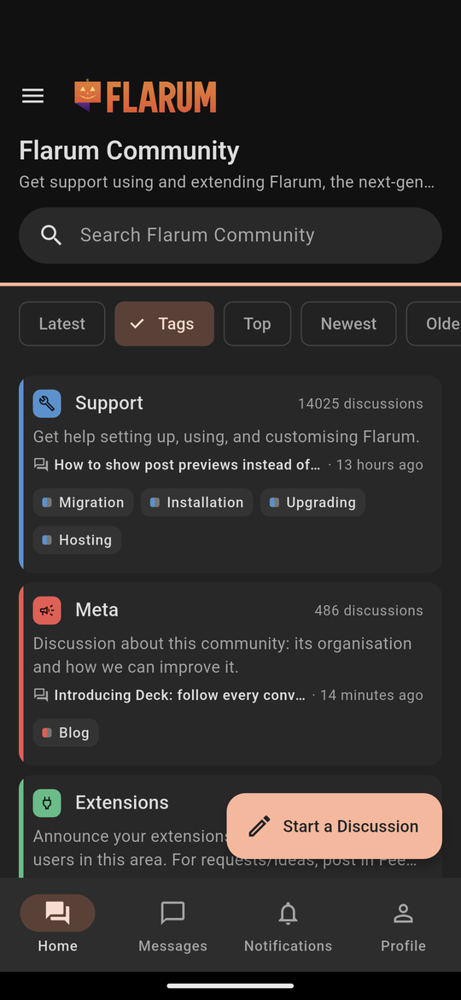
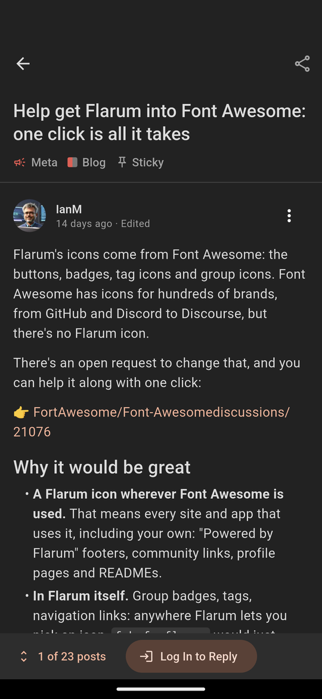
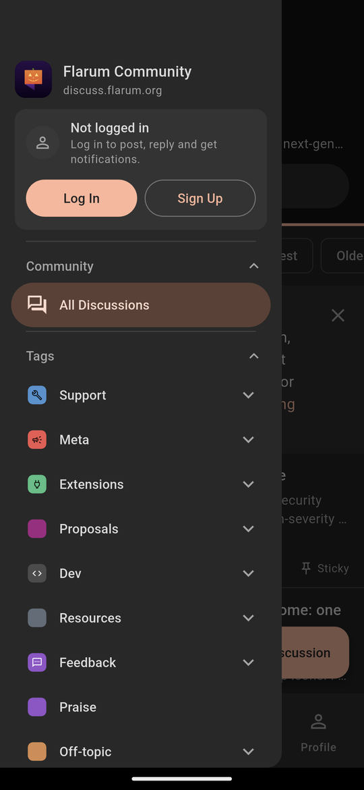

# flarum-app

[](https://github.com/forumcopilot/flarum-app/actions/workflows/ci.yml)

**A free, open-source mobile app for your [Flarum](https://flarum.org) forum.** Point it at your
forum's address, build it, and publish it under your community's name on Google Play and the App
Store.

It is a native Flutter app, not a web view of your site. It talks to Flarum's own REST API, works
with Flarum 1.8 and 2.0, and reads, posts and signs in without anything installed on your forum.
Push notifications come from the companion [Flapp extension](#push-notifications-need-the-flapp-extension),
which is in this repository too. MIT licensed.

<p align="center">
  
  &nbsp;
  
  &nbsp;
  
  &nbsp;
  
</p>
<p align="center"><sub>The app on the Flarum Community (discuss.flarum.org), read as a guest, in dark mode.</sub></p>

flarum-app is an independent project. It is not made by, or affiliated with, the Flarum team.

## What it does

- **Reading:** the forum's discussions with Latest, Top, Newest and Oldest views, and its tags
  (subforums), shown as cards with their child tags. A discussion opens at the reader's last read
  post, with a scrubber, replies and Flarum's event posts. The app also covers search, profiles
  with member cards, and notifications.
- **Writing:** start a discussion within the forum's tag rules, reply, quote and edit.
  - The composer has formatting, @mentions suggested from the discussion's people, uploads
    (fof/upload), polls (fof/polls) and drafts (fof/drafts).
- **Taking part:**
  - Likes and reactions (fof/reactions), with who liked and reacted.
  - Best answers (fof/best-answer).
  - Following discussions and tags (fof/follow-tags), and bookmarks (fof/bookmarks).
  - Private discussions (fof/byobu), and direct messages (flarum/messages, 2.0).
- **Safety and moderation:**
  - Reporting, ignoring members (fof/ignore-users), and accepting the forum's terms (fof/terms).
  - Approving, locking, pinning, hiding and suspending, for moderators.
- **Account:**
  - Sign-in and sign-up through the forum's own pages, so CAPTCHAs and OAuth providers work.
    (Google is the exception: it refuses sign-in inside an app's web view.)
  - Sign-out that revokes the token.
  - A Profile tab with Edit Profile (picture and display name) and notification settings.
- **Layout:** Material 3, as in our [Discourse app](https://github.com/forumcopilot/discourse-app).
  - Tabs for Home, Messages, Notifications and Profile, and a drawer with the forum's tags.
  - The forum's own logo and colours, and light and dark modes.
- **Languages:** English, German, Spanish, French, Italian, Japanese, Korean, Dutch, Portuguese,
  Russian and Chinese.

## Push notifications need the Flapp extension

Flarum has no way for an app to receive notifications by itself. For push, the forum installs the
**Flapp extension**, which is in [`extension/`](extension/) (one version each for Flarum 2.0 and
1.8). The forum then sends each member's notifications to their phone within seconds, in their
language, for the types they choose.

Without the extension, everything else works: members read, post and sign in as usual, and they
see their notifications when they open the app.

To install it, see [extension/README.md](extension/README.md). The extension pushes to members
who use [Flapp](https://flapp.forumcopilot.com), the multi-forum app built on this repository. A
branded app of your own needs its own push setup (a Firebase project, and the relay sending for
it), which we set up as part of a [custom build](#need-it-built-for-you).

## Your forum's app

Edit `packages/flarum_ui/lib/config/app_forum_config.dart`, or pass your forum when you build:

```bash
flutter run --dart-define=FLARUM_URL=https://your.forum --dart-define=FLARUM_NAME="Your Forum"
```

Without these, the app opens the Flarum Community (discuss.flarum.org) as a guest. Before
publishing, change the app's ID (`com.forumcopilot.flarum_app`), its name and its icon. Your app
should carry your community's name, not Flarum's.

## Need it built for you?

The code is free, so you can see exactly what you would get. The project is supported by paid
work: we build and customize apps for forum owners.

- **A white-label app:** your forum's name, icon, colours and splash screen, with push, built and
  published on Google Play and the App Store for you.
- **Deep customization with your organization:**
  - screens for your extensions;
  - sign-in with your existing accounts;
  - integration with your own services;
  - anything else your community needs.

**Get in touch: [forumcopilot@gmail.com](mailto:forumcopilot@gmail.com).** Say which forum it is
for and roughly what you want.

## Sister projects

The same team makes open-source apps for other forum platforms, on the same Flutter foundation:

| Project | Platform | Source |
| --- | --- | --- |
| **flarum-app** *(this repository)* | Flarum 1.8 and 2.0 | [github.com/forumcopilot/flarum-app](https://github.com/forumcopilot/flarum-app) |
| **discourse-app** | Discourse | [github.com/forumcopilot/discourse-app](https://github.com/forumcopilot/discourse-app) |
| **xenforoapp** | XenForo | [github.com/forumcopilot/xenforoapp](https://github.com/forumcopilot/xenforoapp) |

Each also ships as a multi-forum app:
- **Flapp**, for Flarum: [flapp.forumcopilot.com](https://flapp.forumcopilot.com).
- **ABDA**, for Discourse: [betterdiscourse.app](https://betterdiscourse.app).

All of them come from [Forum Copilot](https://forumcopilot.com).

## Layout

- `lib/main.dart`: the runner for one forum.
- `packages/flarum_core/`: the Flarum JSON:API client.
  - Forum info and version detection, sign-in and sign-out, and every read and write the screens
    use.
  - Its tests replay responses recorded from a Flarum 1.8 and a 2.0 forum.
- `packages/flarum_ui/`: the screens, on discourse-app's `forum_kit`.
  - `FlarumApp` runs one forum.
  - `FlarumHost` and `FlarumForumPage` let another app host them, as Flapp does.
- `extension/`: the Flapp extension for push (Flarum 2.0 in `2.x/`, 1.8 in `1.x/`).
- `tool/test_forums/`: seeds the Flarum 1.8 and 2.0 test forums and records the fixtures.
- `docs/`: what each phase found and decided (`phase-0-notes.md` to `phase-4-notes.md`), the UI
  review (`ui-review-notes.md`), and the device checks.

## Development

Flutter 3.38.7 (Dart 3.10), the version CI uses.

```bash
cd packages/flarum_core && flutter pub get && flutter analyze && flutter test
cd packages/flarum_ui && flutter pub get && flutter analyze && flutter test
flutter pub get && flutter analyze && flutter test   # the app, from the repository's root
```

The tests run offline, against the recorded fixtures. To build against a local discourse-app
checkout, copy `pubspec_overrides.yaml.example` to `pubspec_overrides.yaml`. Live tests and
re-recording are described in `packages/flarum_core/test/live_test.dart` and
`tool/test_forums/README.md`. The extension's development is described in
[extension/README.md](extension/README.md).

## License

MIT. See [LICENSE](LICENSE).
